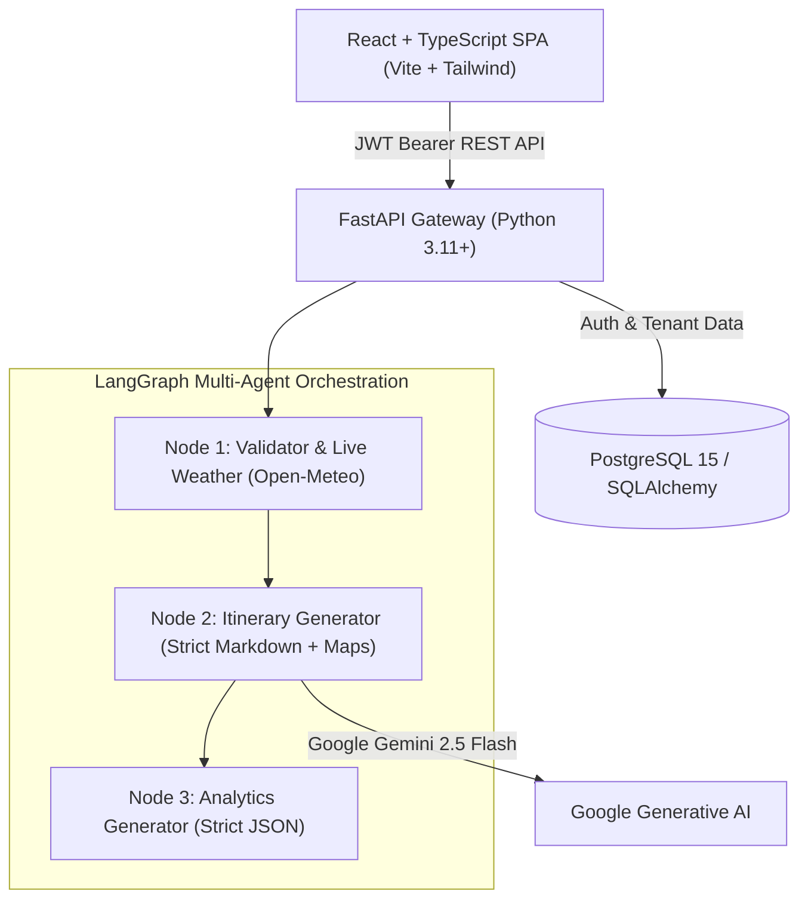

# 🌍 AI Travel Planner Pro — Enterprise SaaS Platform

An investor-ready, decoupled full-stack SaaS platform migrating from a Streamlit prototype into a scalable cloud architecture. Powered by **Google Gemini 2.5 Flash**, **LangGraph multi-agent orchestration**, **FastAPI**, **PostgreSQL**, and a modern **React + TypeScript (Tailwind CSS)** frontend.

---

## 🏗️ System Architecture



### 1. Decoupled Monorepo Structure
- **`/backend`**: FastAPI REST API with SQLAlchemy ORM, JWT authentication (bcrypt + pyjwt), multi-tenant session isolation, and LangGraph multi-agent state machines.
- **`/frontend`**: React 18 with TypeScript, Vite, Tailwind CSS, Lucide Icons, and native Markdown rendering with auto-scrolling chat.
- **`docker-compose.yml`**: Unified single-command orchestration for PostgreSQL, FastAPI, and Nginx-served React.

---

## 🚀 Key Features

* **Multi-Tenant JWT Authentication**: Secure user registration, credential hashing with bcrypt, and token-based tenant isolation.
* **LangGraph Multi-Agent Orchestration**:
  - **Node 1 (Validator & Weather)**: Geographic cleaning and live 3-day forecast from Open-Meteo.
  - **Node 2 (Itinerary Generator)**: Strict markdown itineraries with mandatory Google Maps deep-links for every physical venue.
  - **Node 3 (Analytics Generator)**: High-speed structured JSON tourism metrics (visitors, YoY growth, demographics, best season).
* **Dual-View React UI**:
  - **Interactive Itinerary & Chat**: Auto-scrolling conversational view with Markdown rendering and quick suggestion prompts.
  - **Destination Analytics Panel**: Sleek dashboard rendering key metrics, YouTube travel vlogs, and Maps Explorer.
* **One-Click Itinerary Export**: Download itineraries directly as formatted `.md` files.

---

## 🛠️ Quick Start with Docker Compose

### 1. Clone the repository
```bash
git clone https://github.com/shaimon12/travel_planner.git
cd travel_planner
```

### 2. Configure Environment
```bash
cp .env.example .env
```
Edit `.env` and set your credentials:
```env
GEMINI_API_KEY=
SECRET_KEY=
```

### 3. Spin up the Full Stack
```bash
docker compose up --build -d
```

### 4. Access the Applications
- **Frontend Web Client**: [http://localhost:3000](http://localhost:3000)
- **FastAPI Interactive Docs**: [http://localhost:8000/docs](http://localhost:8000/docs)
- **API Health Check**: [http://localhost:8000/api/health](http://localhost:8000/api/health)

---

## 💻 Standalone Local Development

### Backend (FastAPI)
```bash
cd backend
python3 -m venv .venv
source .venv/bin/activate
pip install -r requirements.txt
cp .env.example .env
uvicorn app.main:app --reload --port 8000
```

### Frontend (React + Vite)
```bash
cd frontend
npm install
npm run dev
```
Client runs at `http://localhost:5173`.

---

## 👨‍💻 Developer & Attribution
Built by **Shaimon Rahman**  
[](https://www.linkedin.com/in/shaimonrahman)
